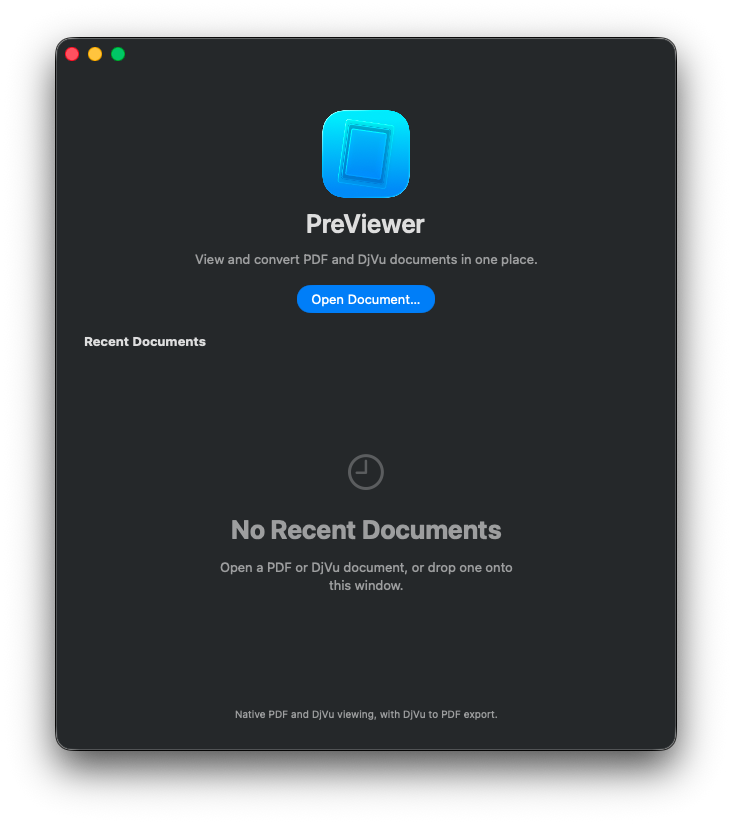
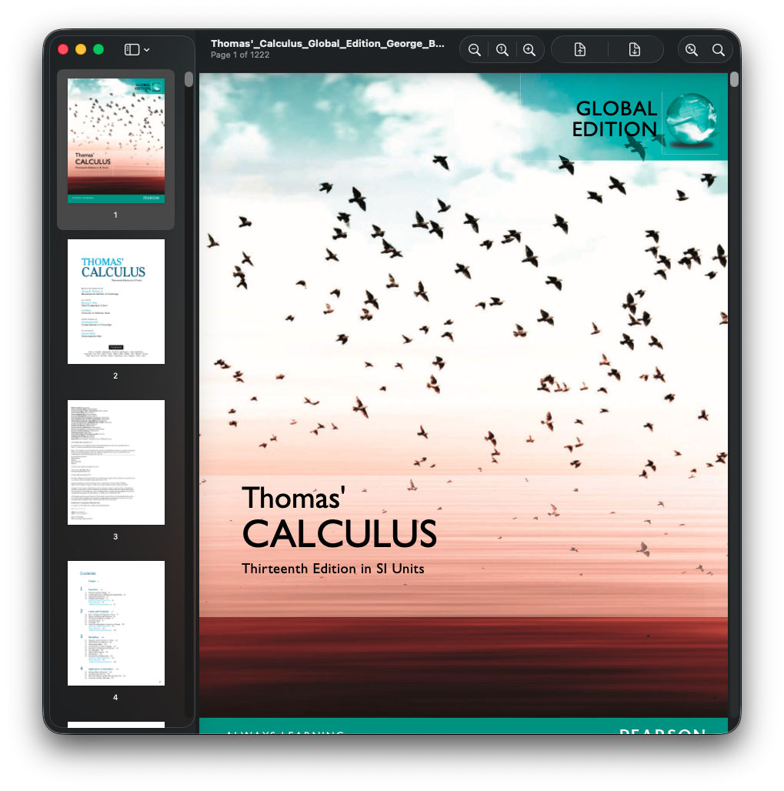
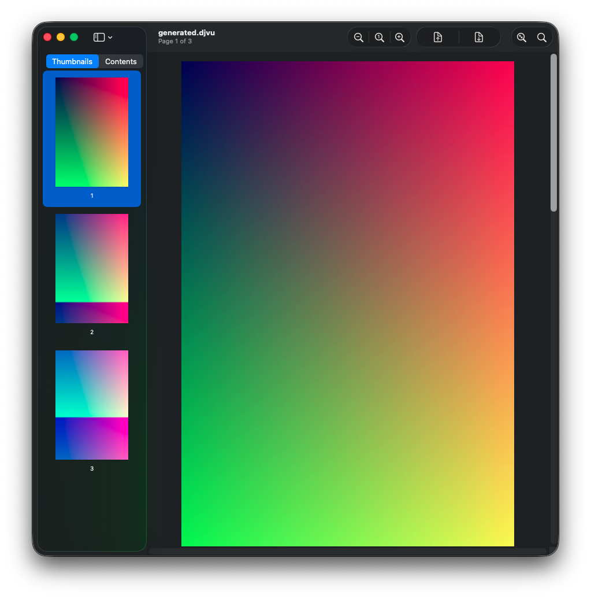
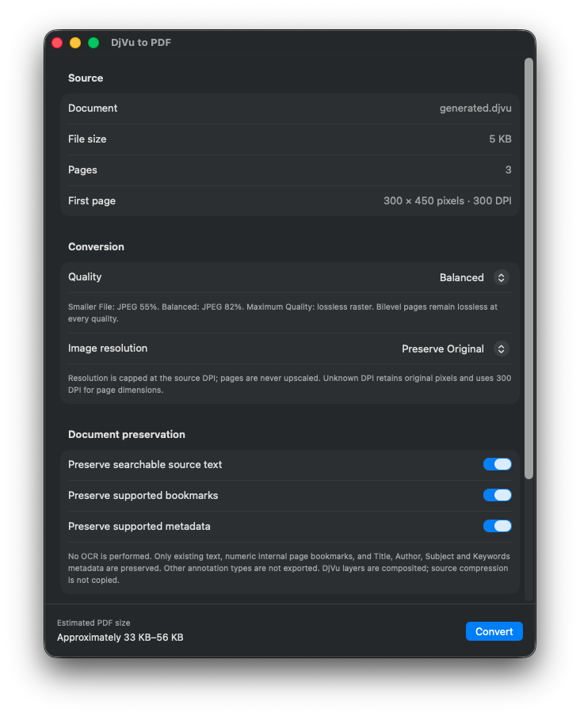
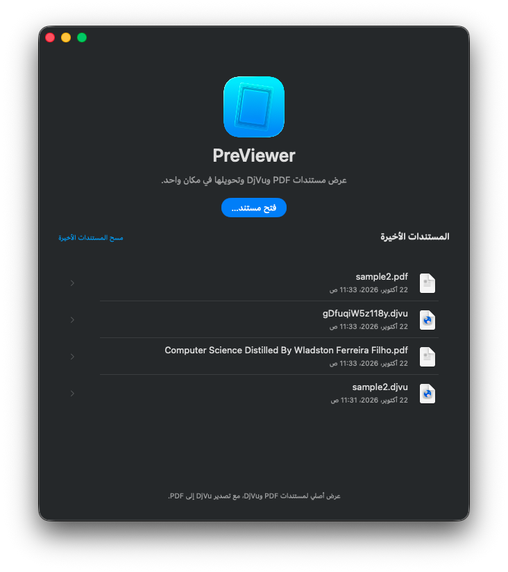
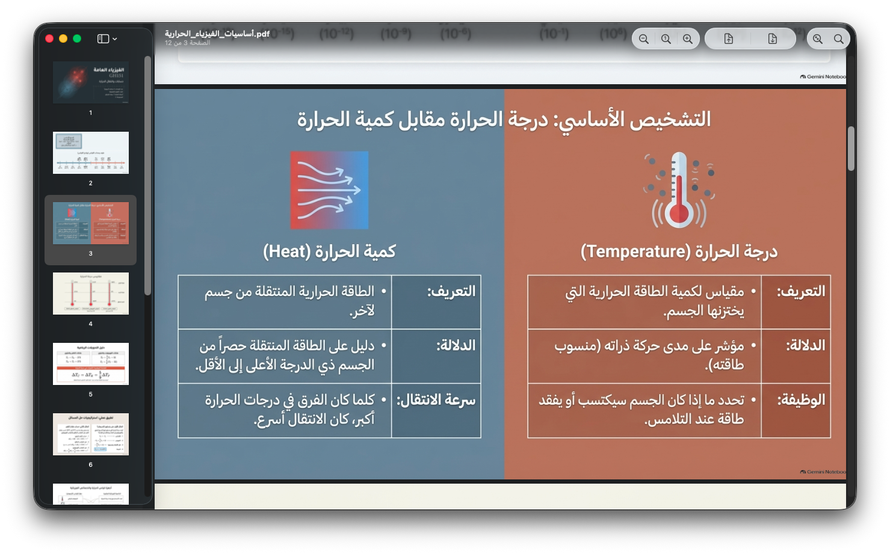
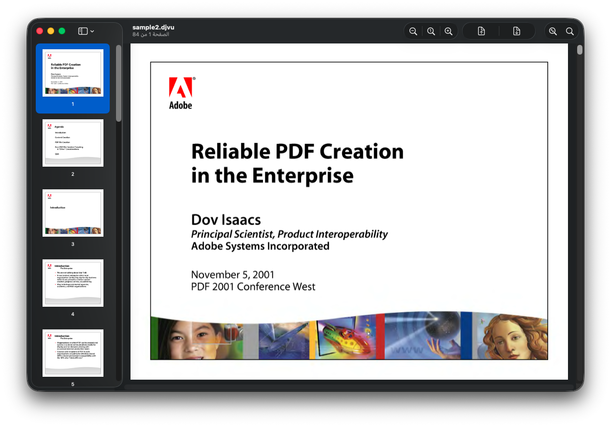
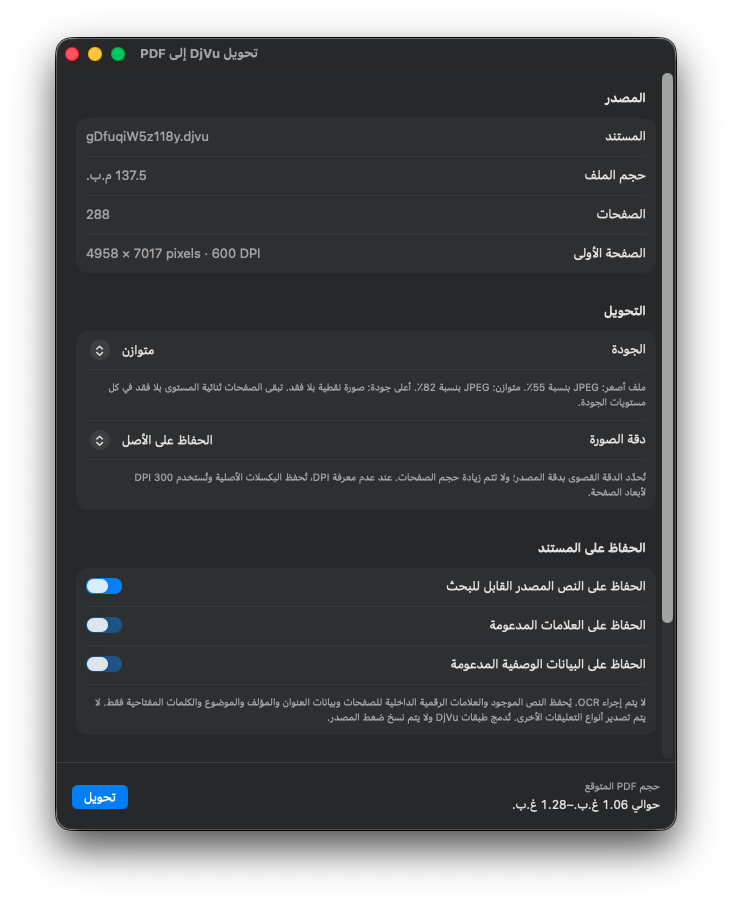

<a id="english"></a>

# PreViewer, a Mac App!

<p dir="ltr">
  <a href="#arabic">العربية</a>
</p>

PreViewer is a lightweight, native macOS viewer for PDF and DjVu documents. It is designed for reading: open a document, browse its pages, search when text is available, select and copy text, and keep your files unchanged.

The interface follows familiar macOS Preview conventions, including a welcome window, recent documents, page thumbnails, continuous scrolling, zoom controls, native menus, drag and drop, and light and dark appearances.

# Screenshots









## Current release

**PreViewer 0.1.2 Beta** is currently available for Intel-based Macs.

Download the ZIP from the [GitHub Releases page](https://github.com/moamenahshad/PreViewer/releases), open it, and drag `PreViewer.app` to your Applications folder. The beta is not notarized with a paid Apple Developer certificate, so macOS may ask you to confirm the first launch.

## Features

- View PDF, `.djvu`, and `.djv` documents
- Browse pages with a thumbnail sidebar
- Continuous scrolling and page navigation
- Zoom in, zoom out, actual size, and fit to window
- Search PDF text and available DjVu text
- Select and copy text from supported DjVu documents
- Welcome screen with recent documents
- Drag and drop files into the app
- Native macOS menus, keyboard shortcuts, and context menus
- Light and dark mode support
- English and Arabic interface support, including right-to-left layout
- Read-only document handling: source files are never edited
- DjVu-to-PDF export with selectable quality and resolution settings

## What is not included yet

PreViewer is intentionally focused on reading and basic DjVu-to-PDF export. The following features are planned or outside the current scope:

- PDF-to-DjVu conversion
- OCR
- Annotations and editing
- MRC compression
- Opening password-protected PDFs that require an unlock password
- Apple Silicon support

## System requirements

- Intel Mac (`x86_64`)
- macOS 26 or later
- No Homebrew, MacPorts, or command-line tools are required to run the released app

The current deployment target is macOS 26 because the bundled native DjVu libraries require it. Apple Silicon support will be considered after the Intel build and document reader have matured.

## Building from source

Building requires Xcode 26.5. Dependencies are already included in the repository; the build does not install anything through Homebrew or MacPorts.

```sh
xcodebuild -project 'DjVu Preview.xcodeproj' -scheme 'DjVu Preview' \
  -configuration Debug -destination 'platform=macOS,arch=x86_64' \
  -derivedDataPath Build -jobs 1 CODE_SIGNING_ALLOWED=NO build

xcodebuild -project 'DjVu Preview.xcodeproj' -scheme 'DjVu Preview' \
  -configuration Debug -destination 'platform=macOS,arch=x86_64' \
  -derivedDataPath Build -jobs 1 -parallel-testing-enabled NO \
  CODE_SIGNING_ALLOWED=NO test
```

The built app is `Build/Build/Products/Debug/PreViewer.app`. The Xcode project and scheme retain the historical name `DjVu Preview`; the product and bundle display name are `PreViewer`.

## Reader details

PDF rendering and PDF search use PDFKit. DjVu pages are decoded lazily with the bundled DjVuLibre backend and rendered directly in the viewer; opening a DjVu does not first create a PDF. Existing DjVu word zones can provide text selection, copying, and search without OCR.

The reader keeps memory use bounded for large books: visible pages are prioritized, off-screen work is cancelled, thumbnails are generated lazily, and raster and DjVu caches have fixed limits. Rendered previews are capped at 4096 pixels on the long edge.

The Contents sidebar can show numeric internal page bookmarks when a DjVu file provides them. Unsupported destinations are disabled. PDF document outlines are handled by PDFKit.

## DjVu-to-PDF export

With a DjVu document open, choose **File > Export** (`Shift-Command-E`). The export window lets you choose quality and resolution, select a destination, monitor progress, and cancel safely. The source DjVu remains unchanged.

Export uses the decoded page image. Existing DjVu word-zone text may be written as an invisible, selectable PDF text layer; no OCR is performed. Supported metadata and numeric page outlines are preserved when available. DjVu layers are composited rather than exported as MRC layers.

## Keyboard shortcuts

| Action | Shortcut |
| --- | --- |
| Open / Welcome / Close | Command-O / Command-N / Command-W |
| Find / Next / Previous match | Command-F / Command-G / Shift-Command-G |
| Previous / Next page | Command-Up / Command-Down |
| Show thumbnails | Option-Command-1 |
| Zoom in / out | Command-Plus / Command-Minus |
| Actual size / Fit to window | Command-0 / Command-9 |
| DjVu export | Shift-Command-E |
| Full screen | Control-Command-F |

## Documentation

- [Architecture](Documentation/architecture.md)
- [Testing guide](Documentation/testing.md)
- [DjVu implementation notes](Documentation/djvu.md)
- [Known limitations](Documentation/limitations.md)
- [Licensing information](Documentation/licensing.md)
- [Dependency notices](Vendor/DjVuLibre/NOTICE.md)

## Licensing

PreViewer does not include Apple Preview resources or proprietary converter code. The bundled DjVuLibre code is licensed under GPL-2.0-or-later. Redistribution must comply with that license, including applicable source and license notice obligations. The application itself does not currently declare a separate root license; see [Documentation/licensing.md](Documentation/licensing.md) before redistributing modified builds.

## Feedback

This is an early beta. If you find a problem, please include the macOS version, Mac architecture, file type, and the steps that reproduced it in a GitHub issue.

---

<div dir="rtl" lang="ar" align="right">

<h1 id="arabic">PreViewer — العربية</h1>

<p>PreViewer تطبيق macOS أصلي وخفيف لعرض مستندات PDF وDjVu. صُمم للقراءة: افتح المستند، تصفح الصفحات، ابحث عندما يتوفر نص، حدد النص وانسخه، واترك ملفاتك دون تعديل.</p>

<p>يوفر التطبيق نافذة ترحيب، والمستندات الأخيرة، والصور المصغرة، والتمرير المستمر، وأدوات التكبير، والقوائم الأصلية، والسحب والإفلات، والمظهرين الفاتح والداكن.</p>

<h2>لقطات الشاشة العربية</h2>

<p></p>
<p></p>
<p></p>
<p></p>

<h2>الإصدار الحالي</h2>

<p><strong>PreViewer 0.1.2 Beta</strong> متوفر لأجهزة Mac بمعمارية Intel.</p>

<p>نزّل ملف ZIP من <a href="https://github.com/moamenahshad/PreViewer/releases">صفحة الإصدارات</a>، وافتحه، ثم اسحب <code>PreViewer.app</code> إلى مجلد Applications.</p>

<p>هذا الإصدار التجريبي غير موثق بتوقيع Apple Developer مدفوع. إذا عرض macOS رسالة أمان، افتح <strong>System Settings → Privacy &amp; Security</strong> ثم اختر <strong>Open Anyway</strong> لتأكيد الفتح.</p>

<h2>الميزات</h2>

<ul>
<li>عرض ملفات PDF و<code>.djvu</code> و<code>.djv</code>.</li>
<li>تصفح الصفحات عبر شريط الصور المصغرة والتمرير المستمر.</li>
<li>التكبير والتصغير والحجم الفعلي وملاءمة النافذة.</li>
<li>البحث في نص PDF ونص DjVu المتاح.</li>
<li>تحديد النص ونسخه من مستندات DjVu التي تحتوي على مناطق كلمات.</li>
<li>دعم العربية والإنجليزية مع تخطيط RTL للعربية.</li>
<li>دعم المظهر الفاتح والداكن والقوائم والاختصارات الأصلية.</li>
<li>قراءة فقط؛ لا يتم تعديل الملفات المصدر.</li>
<li>تصدير DjVu إلى PDF مع خيارات الجودة والدقة.</li>
</ul>

<h2>ما لم يُنفذ بعد</h2>

<ul>
<li>التحويل من PDF إلى DjVu.</li>
<li>OCR والتعليقات والتحرير.</li>
<li>ضغط MRC.</li>
<li>فتح ملفات PDF المحمية التي تتطلب كلمة مرور.</li>
<li>دعم Apple Silicon.</li>
</ul>

<h2>متطلبات النظام</h2>

<ul>
<li>جهاز Mac بمعمارية Intel (<code>x86_64</code>).</li>
<li>macOS 26 أو أحدث.</li>
<li>لا يحتاج المستخدم إلى Homebrew أو MacPorts لتشغيل التطبيق.</li>
</ul>

<h2>التوثيق</h2>

<p><a href="Documentation/architecture.md">البنية</a> · <a href="Documentation/testing.md">دليل الاختبار</a> · <a href="Documentation/djvu.md">ملاحظات DjVu</a> · <a href="Documentation/limitations.md">القيود المعروفة</a> · <a href="Documentation/licensing.md">الترخيص</a></p>

<p><a href="#english">English</a></p>

</div>
